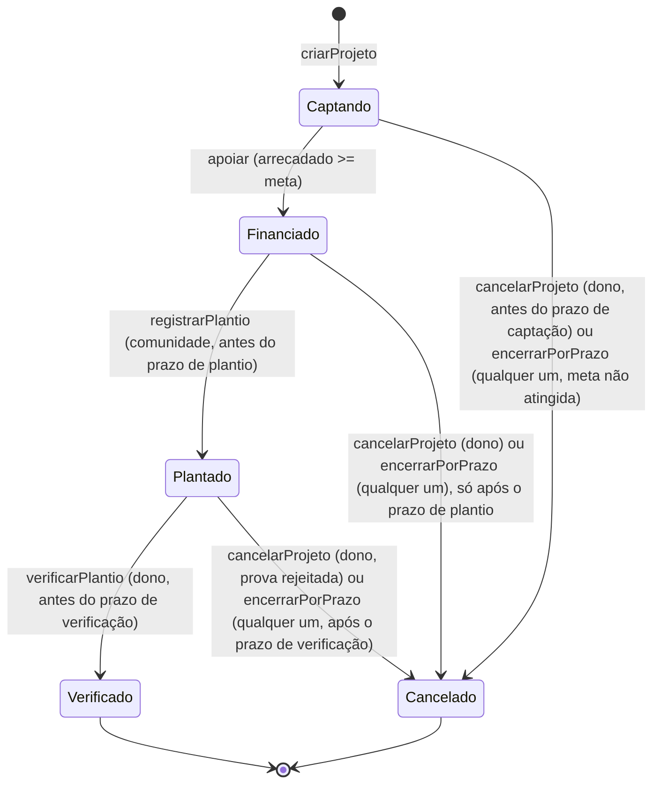

# Floresta Viva

dApp de **financiamento coletivo de reflorestamento na Amazônia**, em Solidity, na rede de testes **Ethereum Sepolia**.

## 1. Tema e problema

Comunidades e viveiros cadastrados criam projetos de plantio (ex.: "500 mudas de castanheira em Manacapuru") com meta em ETH e prazo. Qualquer pessoa pode apoiar. O dinheiro sai **em duas parcelas**:

- **50% quando a meta é atingida**, para a comunidade comprar as mudas;
- **50% só depois que a comunidade registra a prova do plantio (hash) e o verificador (dono do contrato) a valida**.

Se algo falhar (meta não atingida, plantio não registrado, prova rejeitada ou verificador omisso), os apoiadores recuperam o que ficou retido no contrato.

**Problema:** em campanhas de reflorestamento o doador não sabe se o dinheiro virou árvore. **Por que blockchain:** o doador vê onde está cada wei, a regra de liberação é código público que ninguém altera, e a prova do plantio fica gravada para sempre. O doador só paga a segunda metade pelo que foi plantado e verificado.

## 2. Integrantes e papéis

Papéis sugeridos pelo guia do trabalho, usados para organizar o trabalho. Todos os integrantes devem saber explicar o contrato e o frontend.

| Integrante | Papel |
|---|---|
| <!-- PREENCHER: nome 1 --> | Desenvolvedor(a) do contrato |
| <!-- PREENCHER: nome 2 --> | Desenvolvedor(a) frontend |
| <!-- PREENCHER: nome 3 --> | Integração Web3 |
| <!-- PREENCHER: nome 4 --> | Documentação e QA |

## 3. Dados do deploy (Sepolia, Chain ID 11155111)

| Item | Valor |
|---|---|
| Endereço do contrato | `0x492e97B6C7f47113cb0A294149717f9E16c76E7B` |
| Etherscan | https://sepolia.etherscan.io/address/0x492e97B6C7f47113cb0A294149717f9E16c76E7B |
| Transação de deploy | [`0x8c0b122ebe94d8cea60075002c51164b8b0da865ab1cef6b5fbe7ae5e02faa0e`](https://sepolia.etherscan.io/tx/0x8c0b122ebe94d8cea60075002c51164b8b0da865ab1cef6b5fbe7ae5e02faa0e) |
| Bloco do deploy | 12141726 (15/11/2026) |
| Dono / verificador | `0xbcc3b5e06c1bb35458c8de242573dba669154fb6` |
| Argumento do constructor | `prazoVerificacaoMin = 5` (prazo de verificação de 300 s, para a demo) |
| Compilação (Remix) | solc 0.8.34, optimizer ligado (200 runs), arquivo único, licença MIT |

Passo a passo do deploy e da verificação: [docs/DEPLOY.md](docs/DEPLOY.md).

## 4. Aplicação publicada (Vercel)

URL: <!-- PREENCHER: https://<projeto>.vercel.app -->

## 5. Diagrama de estados



`Verificado` e `Cancelado` são estados finais. Depois que um prazo vence, só `encerrarPorPrazo` decide o destino do projeto: não existe segundo em que o projeto esteja "aberto" e "encerrável" ao mesmo tempo (as checagens usam `<` e `>=` sobre o mesmo limite).

### Regras de dinheiro

- **Liberado à comunidade** (calculado em `disponivelParaSaque`): `Financiado`/`Plantado` = 50% do arrecadado; `Verificado` = 100%; `Captando`/`Cancelado` = nada novo. Disponível = liberado − sacado.
- **Cancelamento** grava `saldoReembolsavel = arrecadado − sacado`. Se a comunidade não sacou a 1ª parcela antes do cancelamento, perde esse direito (o valor vai para os apoiadores).
- **Reembolso** = `contribuição × saldoReembolsavel / arrecadado`. O último apoiador a reembolsar recebe o que sobrou (`saldoReembolsavel − totalReembolsado`), então nenhum wei fica preso por arredondamento.
- **Reputação** da comunidade (`int256`): +1 ao ser verificada; −1 em qualquer cancelamento feito pelo dono e no `encerrarPorPrazo` de projeto `Financiado` (plantio não registrado). Sem penalidade no `encerrarPorPrazo` de meta não atingida (`Captando`) nem de verificador omisso (`Plantado`). Abaixo de −2 (`REPUTACAO_MINIMA`) a comunidade não cria projetos.
- Limites: no máximo 3 projetos ativos por comunidade (`MAX_PROJETOS_ATIVOS`) e 20 no total (`MAX_PROJETOS_POR_COMUNIDADE`).

## 6. Funções do contrato

Arquivo: [contracts/FlorestaViva.sol](contracts/FlorestaViva.sol). Os erros `ProjetoInexistente` e `NaoAutorizado` também podem vir dos modificadores de cada função.

| Função | Quem chama | Efeito | Eventos | Erros / `require` |
|---|---|---|---|---|
| `constructor(prazoVerificacaoMin)` | quem implanta | define `dono` e `prazoVerificacaoSeg` (ambos `immutable`) | nenhum | `require`: prazo entre 1 e 525.600 min |
| `cadastrarComunidade(conta, nome)` | dono | cadastra; se já existe, só reativa e atualiza o nome (mantém reputação e histórico) | `ComunidadeCadastrada` | `NaoAutorizado`; `require`: endereço não zero, não pode ser o dono, nome de 1 a 80 bytes |
| `desativarComunidade(conta)` | dono | impede só **novos** projetos; os existentes seguem (a comunidade ainda registra plantio e saca) | `ComunidadeDesativada` | `NaoAutorizado`; `require`: comunidade cadastrada |
| `criarProjeto(titulo, local, mudas, meta, durCaptacaoMin, durPlantioMin)` | comunidade ativa | cria o projeto em `Captando`; prazos informados em minutos | `ProjetoCriado` | `NaoAutorizado`, `ReputacaoInsuficiente`, `LimiteDeProjetosAtingido` (3 ativos ou 20 no total); `require`: textos de 1 a 80 bytes, mudas > 0, meta > 0, durações de 1 a 525.600 min |
| `apoiar(id)` `payable` | qualquer endereço | soma a contribuição; o apoio que faz `arrecadado >= meta` muda para `Financiado` e grava `prazoPlantio` (excedente aceito) | `ApoioRecebido`, `ProjetoFinanciado` | `EstadoInvalido`, `ValorInvalido` (valor 0), `PrazoEncerrado` |
| `registrarPlantio(id, prova)` | comunidade do projeto | `Financiado → Plantado`; grava o hash e `prazoVerificacao` | `PlantioRegistrado` | `NaoAutorizado`, `EstadoInvalido`, `PrazoEncerrado`; `require`: prova ≠ `bytes32(0)` |
| `verificarPlantio(id)` | dono | `Plantado → Verificado`; reputação +1; libera os 100% | `PlantioVerificado` | `NaoAutorizado`, `EstadoInvalido`, `PrazoEncerrado` |
| `cancelarProjeto(id, motivo)` | dono | cancela conforme o estado (ver seção 5); reputação −1 | `ProjetoCancelado` | `NaoAutorizado`, `PrazoEncerrado` (Captando/Plantado vencidos), `PrazoNaoEncerrado` (Financiado antes do prazo), `EstadoInvalido` (estado final) |
| `encerrarPorPrazo(id)` | **qualquer um** | cancela projeto cujo prazo da etapa venceu; nenhum ETH fica preso por inação do dono | `ProjetoCancelado` | `PrazoNaoEncerrado`, `EstadoInvalido` |
| `sacar(id)` | comunidade do projeto | envia `disponivelParaSaque`; usa `semReentrada` | `SaqueRealizado` | `NaoAutorizado`, `NadaASacar`, `TransferenciaFalhou`; `require`: sem reentrada |
| `pedirReembolso(id)` | apoiador | em `Cancelado`, zera a contribuição e envia a parte proporcional | `ReembolsoRealizado` | `EstadoInvalido`, `NadaAReembolsar`, `TransferenciaFalhou`; `require`: sem reentrada |

Leitura e auxiliares:

| Função | Visibilidade | Descrição |
|---|---|---|
| `totalProjetos()` | `public view` | quantidade de projetos |
| `obterProjeto(id)` | `external view` | struct `Projeto` completa (17 campos) |
| `projetosDaComunidade(conta)` | `external view` | ids dos projetos da comunidade |
| `disponivelParaSaque(id)` | `public view` | liberado − sacado (usada por `sacar` e pela UI) |
| `valorReembolsavel(id, apoiador)` | `public view` | quanto o apoiador recebe se pedir reembolso agora |
| `calcularPrimeiraParcela(valor)` | `public pure` | 50% do valor |
| `_cancelar`, `_validarDadosProjeto`, `_contarProjetosAtivos` | `internal` | cancela e grava saldo; valida dados; conta projetos ativos (laço limitado) |
| `_transferir(para, valor)` | `private` | `call{value:}` com verificação de sucesso |

Getters automáticos: `dono`, `prazoVerificacaoSeg`, `comunidades(conta)` (nome, cadastrada, ativa, reputação), `contribuicoes(id, apoiador)`, `totalApoiadoPor(conta)` e as constantes.

**Eventos** (todos com campos `indexed`): `ComunidadeCadastrada`, `ComunidadeDesativada`, `ProjetoCriado`, `ApoioRecebido`, `ProjetoFinanciado`, `PlantioRegistrado`, `PlantioVerificado`, `ProjetoCancelado`, `SaqueRealizado`, `ReembolsoRealizado`.

**Erros personalizados:** `NaoAutorizado`, `ProjetoInexistente`, `EstadoInvalido`, `PrazoNaoEncerrado`, `PrazoEncerrado`, `ValorInvalido`, `NadaASacar`, `NadaAReembolsar`, `ReputacaoInsuficiente`, `LimiteDeProjetosAtingido`, `TransferenciaFalhou`. O frontend traduz cada um para português.

## 7. Recursos exigidos e onde estão no código

Cada ocorrência está marcada no `.sol` com `// [Recurso: <Grupo>]` e as funções públicas/externas têm NatSpec. Linhas de `contracts/FlorestaViva.sol`.

| Grupo | Onde (linha) | Por que |
|---|---|---|
| **TiposDeDados** | `uint256` em valores e prazos (struct `Projeto`, l.19-37); `int256` na reputação (l.45) e em `REPUTACAO_MINIMA` (l.57); `bool` em `ativa`/`cadastrada` (l.43-44) e `travado` (l.87); `address payable` em `dono` (l.63) e `comunidade` (l.21); `string` em título, local e motivo; `bytes32` em `provaPlantio` (l.35); `immutable` em `dono` (l.63) e `prazoVerificacaoSeg` (l.67); `constant` (l.54-59) | tipo certo para cada dado: dinheiro e prazos sem sinal, reputação que pode ficar negativa, hash de 32 bytes, endereço que recebe ETH |
| **Funcoes** | `external` (ex.: `criarProjeto` l.291, `apoiar` l.374 `payable`, `sacar` l.442); `public` (`totalProjetos` l.349, `disponivelParaSaque` l.418, `valorReembolsavel` l.596); `view` (l.274, 357, 418, 596); `pure` (`calcularPrimeiraParcela` l.408, `_validarDadosProjeto` l.670); `internal` (`_cancelar` l.650, `_contarProjetosAtivos` l.694); `private` (`_transferir` l.661); `constructor` (l.217) | cada visibilidade tem uso real: ações da UI são `external`, leituras reaproveitadas por outras funções são `public`, auxiliares ficam `internal`/`private` |
| **EstruturasDeControle** | `if/else` na liberação de valores (l.427-433), no cadastro (l.245-253), no cancelamento (l.529-550) e no encerramento (l.564-581); `for` limitado em `_contarProjetosAtivos` (l.696); `require` em validações (l.204, 218, 239-242, 479, 678-689) | a regra de negócio depende do estado; o `for` é limitado por `MAX_PROJETOS_POR_COMUNIDADE`, então o gas é previsível |
| **ArraysEMappings** | array dinâmico `Projeto[] projetos` (l.71, id = índice); `uint256[] projetos` dentro de `Comunidade` (l.46, push na l.341); mapping para struct `comunidades` (l.75); mapping aninhado `contribuicoes[id][apoiador]` (l.79, uso na l.392); mapping simples `totalApoiadoPor` (l.83) | lista de projetos, busca direta por endereço, contribuição por projeto e por pessoa, "seu impacto" total |
| **StructsEEnums** | `enum Status` (l.15); `struct Projeto` com **17 campos** (l.19-37); `struct Comunidade` (l.41-47); criação do `Projeto` na l.320 | o ciclo de vida vira enum (sem números mágicos) e os dados de cada projeto ficam agrupados |
| **Modificadores** | 6 próprios: `apenasDono` (l.155), `apenasComunidadeAtiva` (l.164), `apenasComunidadeDoProjeto(id)` (l.173), `projetoExiste(id)` (l.185), `noEstado(id, esperado)` (l.194), `semReentrada` (l.203); 3 recebem parâmetro | controle de acesso, checagem de estado e proteção contra reentrância reutilizados em várias funções |
| **EventosEErros** | 10 eventos com `indexed` (l.95-119); 11 erros personalizados (l.127-147) usados com `revert`; `require` com mensagem | o frontend monta o histórico a partir dos eventos e decodifica os erros para mensagens em português |

## 8. Como rodar localmente

Frontend (HTML/CSS/JS puros, sem build). A partir da raiz do repositório:

```bash
npx serve frontend
```

Ou abra `frontend/index.html` com a extensão Live Server do VS Code. É preciso ter a MetaMask no navegador. O endereço e o bloco do contrato implantado já estão em `frontend/contrato.js`.

Testes automatizados do contrato (57 testes):

```bash
npm install
npm test
```

**Hardhat e ethers foram usados apenas como apoio para os testes automatizados locais** (biblioteca de suporte citada). Não foram usados para o deploy: o contrato foi compilado, testado e implantado no **Remix IDE** com "Injected Provider – MetaMask". O frontend usa **somente Web3.js 4.x** (CDN, versão fixa).

## 9. Configurar a MetaMask na Sepolia

1. Instale a extensão MetaMask e crie/importe uma conta (nunca compartilhe a frase de recuperação).
2. Na lista de redes, ative "Mostrar redes de teste" e escolha **Sepolia** (Chain ID 11155111). Se a rede não aparecer, a dApp oferece o botão "Trocar para Sepolia".
3. Pegue SepoliaETH no faucet do Google Cloud: https://cloud.google.com/application/web3/faucet/ethereum/sepolia (cole o endereço da conta; repita para cada conta da demo).
4. Para o teste completo use **3 contas** na mesma MetaMask (Dono, Comunidade, Apoiador), cada uma com SepoliaETH.

## 10. Roteiro de teste para o avaliador

Contas: **Dono** (`0xbcc3b5e06c1bb35458c8de242573dba669154fb6`, quem implantou), **Comunidade** (qualquer conta que o Dono cadastre) e **Apoiador** (qualquer outra conta). Em cada ação a MetaMask abre a confirmação; o app mostra o hash com link do Etherscan e o estado pendente, depois confirmada ou falhou. O prazo de verificação deste deploy é de 5 minutos.

**Preparação.** Abra a URL da Vercel (seção 4) e conecte a conta **Dono**. No painel do verificador, cadastre o endereço da conta Comunidade com um nome.

**A. Fluxo de sucesso**
1. Conta **Comunidade**: em "Criar projeto", preencha título, local, 100 mudas, meta `0,01` ETH, captação 10 min, plantio 30 min.
2. Conta **Apoiador**: no card do projeto, apoie com `0,01` ETH. O projeto passa a **Financiado** (meta atingida na mesma transação).
3. Conta **Comunidade**: clique em "Sacar" (50% = 0,005 ETH).
4. Conta **Comunidade**: no card, escolha um arquivo (foto/laudo) em "Prova do plantio". O navegador calcula o `keccak256` e envia o hash. O projeto passa a **Plantado** (o arquivo não sai do computador).
5. Conta **Dono** (dentro de 5 min): "Verificar plantio". O projeto passa a **Verificado** e a reputação da comunidade sobe para 1.
6. Conta **Comunidade**: "Sacar" de novo (restante, 0,005 ETH).
7. Confira o "Histórico de eventos" e a transação no Etherscan.

**B. Fluxo de reembolso**
1. Conta **Comunidade**: crie outro projeto com meta `1` ETH, captação 2 min.
2. Conta **Apoiador**: apoie com `0,005` ETH (meta não atingida).
3. Aguarde 2 min. Qualquer conta: "Encerrar projeto" (`encerrarPorPrazo`). O projeto passa a **Cancelado**, sem penalidade de reputação (meta não atingida).
4. Conta **Apoiador**: "Reembolsar" e receba os 0,005 ETH de volta.

**C. Erros provocados**
- **Saldo insuficiente**: na conta Apoiador, digite um valor maior que o saldo (ex.: `1000` ETH) e clique em "Apoiar". A UI avisa o saldo antes de abrir a MetaMask.
- **Erro do contrato decodificado** (`EstadoInvalido`): abra o app em duas abas com um projeto em captação; na aba 2 apoie até atingir a meta (projeto vira Financiado); na aba 1, sem recarregar, clique em "Apoiar". A UI mostra "Ação indisponível: o projeto está em Financiado", obtida da ABI antes de gastar gas.
- **Transação rejeitada**: clique em "Rejeitar" na MetaMask; a UI mostra mensagem de transação cancelada.
- **Rede errada**: troque a MetaMask para outra rede; aparece o banner e as ações de escrita ficam bloqueadas.
- O contrato também reverte com `PrazoNaoEncerrado` (ex.: `encerrarPorPrazo` antes do vencimento) e `PrazoEncerrado`; a UI esconde os botões fora do prazo, então esses erros só aparecem na fronteira do prazo ou ao chamar o contrato direto (Remix/Etherscan).

## 11. Segurança

- **Checks-effects-interactions**: `sacar` e `pedirReembolso` atualizam `sacado`, contribuições e totais **antes** de enviar o ETH.
- **`semReentrada`**: modificador próprio (variável `travado`) em `sacar` e `pedirReembolso`.
- **Pull payment**: o contrato nunca envia ETH dentro de outras funções; quem tem direito pede (`sacar`, `pedirReembolso`). Toda transferência usa `call{value:}` com verificação (`TransferenciaFalhou`).
- **Prazos públicos**: `encerrarPorPrazo` pode ser chamada por qualquer pessoa, então nenhum projeto fica preso por inação do dono (mesmo que ele perca a chave).
- **Sem `receive`/`fallback`**: ETH enviado direto ao contrato é rejeitado; o único caminho é `apoiar`.
- **Sem resto preso**: o último reembolso absorve o arredondamento.
- Desativar uma comunidade não trava valores já devidos (`sacar` e `registrarPlantio` não exigem comunidade ativa).
- A divisão do reembolso só ocorre após a checagem `contribuição == 0` (sem divisão por zero em projeto cancelado sem apoios).
- Solidity 0.8.x: verificação de overflow nativa.
- Nenhuma chave privada ou frase de recuperação no repositório.

## 12. Limitações conhecidas

- **Dono único verificador**: a validação do plantio é centralizada (o dono é `immutable`, sem transferência de propriedade).
- **Prova é só um hash**: o contrato não consegue conferir o conteúdo do arquivo nem se o plantio ocorreu; confia no dono.
- **Pull payment**: valores devidos (parcelas da comunidade, reembolsos não pedidos) ficam no contrato até o titular pedir.
- **Endereço que rejeita ETH**: uma comunidade cujo endereço rejeite ETH (ex.: contrato sem `receive`) não consegue sacar; o dono deve cadastrar só contas comuns.
- **Limite de 20 projetos por comunidade conta o histórico inteiro** (necessário para limitar o laço).
- **Auto-financiamento**: uma comunidade pode apoiar o próprio projeto a partir de outro endereço para atingir a meta e sacar os 50%. O contrato não impede isso; a mitigação é só a reputação.
- **`totalApoiadoPor` é bruto**: reembolsos não são subtraídos.
- **`getPastEvents` depende do RPC da carteira**: o histórico de eventos pode falhar ou ficar incompleto em RPCs que limitam o intervalo de blocos.
- **Prazo de verificação fixo no deploy**: 5 minutos na demo (em produção seria da ordem de 7 dias).
- O dono **não** cancela um projeto em `Captando` depois do `prazoCaptacao`: só `encerrarPorPrazo` (sem penalidade).
- A comunidade perde a 1ª parcela não sacada se o projeto for cancelado antes do saque.
- Sem leitura sem carteira conectada (RPC público).

## 13. Melhorias futuras

- Verificação descentralizada (votação de apoiadores ou oráculos) em vez de dono único; multisig.
- Parcelas por marcos (N etapas) e prazo de verificação configurável por projeto.
- Prova em armazenamento descentralizado (IPFS) com o CID junto ao hash.
- NFT/certificado de apoio e créditos de carbono.
- Leitura sem carteira via RPC público e histórico via indexador.
- Bloquear auto-financiamento com identidade/lista de endereços da comunidade.

## 14. Vídeo de demonstração

Link: <!-- PREENCHER: link do vídeo (3 a 5 min) -->

## Estrutura do repositório

```
contracts/FlorestaViva.sol      contrato (arquivo único, sem imports)
frontend/                       index.html, style.css, app.js, contrato.js (ABI + endereço)
test/FlorestaViva.test.js       testes automatizados locais (Hardhat)
scripts/exportar-abi.js         gera a ABI de frontend/contrato.js
docs/DEPLOY.md                  passo a passo de deploy
docs/APRESENTACAO.md            roteiro da apresentação e da demo
docs/prints/                    prints do Remix e da dApp
```
